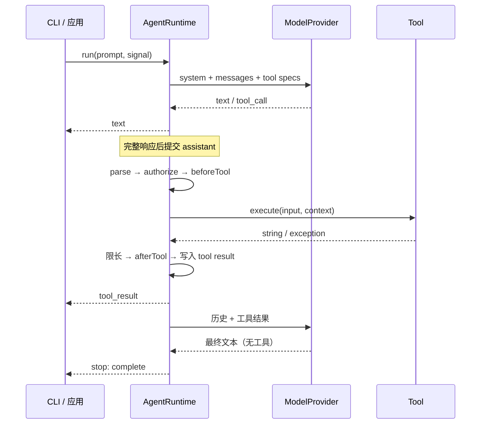

# 从一轮请求理解 Sato

先读 `src/types.ts`，再沿 `src/runtime.ts` 跟踪一轮离线演示。

## 三个边界

1. 模型边界：runtime 只理解文本片段和完整 `ToolCall`，不理解厂商 SSE 字段。Provider 接收消息快照，不能直接改内部历史。
2. 工具边界：模型传来的参数是 `unknown`。JSON Schema 帮助模型生成参数，`parse()` 才负责程序端验证。
3. 展示边界：CLI 只消费事件。换成网页或编辑器界面，可以复用同一个 runtime。

## 消息完整性

用户回合中可能有多次模型请求。每个 assistant 可包含多个工具调用，每个调用必须对应一个工具结果。

模型流还没有完整结束时，只向 UI 输出文本，不把半截 assistant 提交到历史。中途网络失败，下一次请求不会携带损坏的工具参数。UI 已显示的文本只是暂态输出，不能作为已提交历史的证据。

完整响应提交前验证调用 ID：空 ID、历史重复 ID、批内重复 ID 均失败。未知工具、参数错误、权限拒绝、Hook 阻断、执行异常则生成 `isError: true` 的结果，供模型理解并修正。

工具批次由 `try/finally` 包围。调用者在 `tool_start` 后 `break`，或取消剩余操作时，`finally` 为尚未完成的调用补齐失败结果。调用者应使用 `for await`，或显式调用迭代器的 `return()`；仅仅丢弃一个仍暂停的迭代器不会触发清理。

## 权限和 Hooks

执行顺序固定为：参数验证 → 权限 → beforeTool → signal 检查 → execute → 结果限长 → afterTool。

权限不会交给 Hooks 决定。传给确认函数与 Hooks 的调用、结果都是副本，避免观察代码改写即将执行的参数。`afterTool` 异常追加诊断信息，不抹掉工具的原始执行结果。自定义工具声明的 `readOnly` 必须真实可靠；内置权限系统不能验证扩展程序的实际行为。

`read-only` 优先于确认函数，防止确认意外放开写入。所有工具仍执行文件路径边界检查，`allow-write` 只免除确认。

## 预算与终止

| 参数 | 默认值 | 语义 |
| --- | --- | --- |
| `maxTurns` | 12 | 每次 run 的最大模型请求次数 |
| `maxContextChars` | 100000 | 序列化 messages 的字符预算 |
| `maxToolOutputChars` | 12000 | 单个工具输出保留字符数，之后追加截断标记 |
| `toolTimeoutMs` | 30000 | 参数验证之后的执行管线协作取消信号 |
| `requestTimeoutMs` | 120000 | 单个模型请求的取消信号 |

上下文预算是估算，不包含 system/tool schema，也不是模型 tokenizer。裁剪只作用于发给模型的视图：删除最早的完整用户回合，不拆散工具调用/结果，不改变保存的完整历史。当前回合本身过大则报错停止，避免静默丢失本轮证据。无自动摘要。

`stop.reason` 有 `complete`、`cancelled`、`max_turns`、`error`。达到轮次限制时不会伪造最终回答。provider 错误会先产生 `error` 事件，再产生 `stop`；工具错误是回填结果，通常可由模型修复。

一个 runtime 同时只允许一个 run。多会话使用多个实例，磁盘会话文件也应不同。会话只在 CLI 回合结束时保存，没有每条事件的崩溃恢复或多进程文件锁。

## 错误分类与恢复

`SatoError` 保留 `cause`，`errorInfo()` 只输出稳定字段。运行时错误事件在原有 `message` 之外增加 `code` / `retryable`；工具失败结果可带同结构的 `error`，旧的 `isError` / `content` 仍然可用。

| 错误码 | 行为 |
| --- | --- |
| `MODEL_HTTP` | 带 HTTP status；401/403 提示检查权限，429/5xx 标记可能可重试 |
| `MODEL_NETWORK` | 建连失败或流读取中断，保留原因；不自动重放请求 |
| `MODEL_PROTOCOL` | 空响应、损坏事件、非法调用 ID、SSE JSON/完整性/帧大小错误；停止且不提交半包 |
| `REQUEST_TIMEOUT` | 包括 provider 自行吞掉取消后静默结束的情况；停止且不提交响应 |
| `TOOL_NOT_FOUND` / `TOOL_INPUT` | 工具不存在或参数验证失败；配对回填 |
| `PERMISSION_DENIED` / `TOOL_HOOK` | 授权未通过、beforeTool 阻断或失败；配对回填 |
| `TOOL_EXECUTION` / `TOOL_TIMEOUT` | 执行异常、返回值不是字符串或超时；不自动重试副作用 |
| `CANCELLED` | 工具取消或调用者提前关闭迭代器时补齐结果；用户取消结束本轮 |
| `CONTEXT_BUDGET` | 当前回合过大，停止，需调整预算或新建会话 |
| `SESSION_READ` / `SESSION_WRITE` | 明确文件与操作，保留底层 cause；CLI 非零退出 |
| `RUNTIME_ERROR` | 未分类错误；仍走 error → stop，不伪装为完成 |

`retryable` 只表示故障可能是暂时的。调用方仍要根据工具副作用和已提交历史决定如何恢复，不能直接重复整个用户回合。已有工具调用成功、下一次模型请求失败时，已完成结果保留在历史中。

会话与文件编辑使用同目录临时文件写完后重命名。提交之前写入或取消失败，不会截断旧文件；失败后尝试删除临时文件。如果清理也失败，会把两次错误保留在 cause 中。原子替换并不提供断电持久性保证、事务回滚或多进程冲突控制。新文件创建仍可能在底层写入失败后留下未完成的新文件，需检查工具反馈与文件状态。

CLI 初始化时验证工作区，损坏会话不静默重置。终端 EOF 会取消正在进行的回合，空闲 Ctrl+C 中止等待输入；保存失败单独显示持久化错误，并不把模型输出已经显示当作保存成功。

## 添加工具

实现 `Tool`：提供名称、描述、JSON Schema、`readOnly`、`parse()`、`execute()`，然后把它放到 `RuntimeOptions.tools` 中。

`execute()` 接收 `{ workspace, signal }`，应在副作用之前检查 signal，并把它传给支持取消的 API。不要用“Promise 超时后返回”假装停止后台副作用。若需要运行不可信工具，应在独立进程或容器中设计强制终止和隔离，这是当前教学版本的扩展课题。
